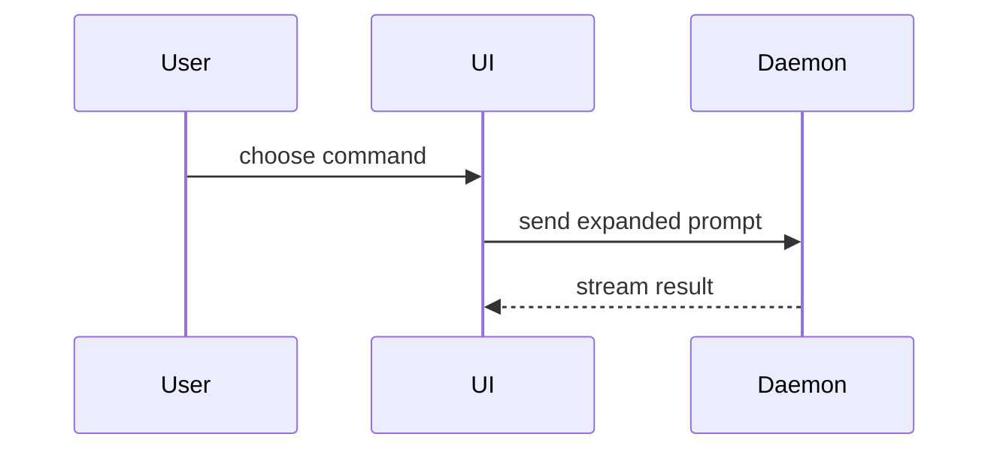

# PR body

Adapted from Matt Pocock's `pr` skill (see [CREDITS.md](./CREDITS.md)).

**The repo's own template wins.** If the repo ships a PR/MR template
(`.github/PULL_REQUEST_TEMPLATE*`, `.gitlab/merge_request_templates/*`), fill that template and
use the guidance below only for its free-text sections. Otherwise use this template:

```markdown
## Summary

<diagram, diff-sketch, or tree>

## Evidence

- **Before:** <screenshot/output/failing test run>
  **After:** <screenshot/output/passing test run>

## Merge Danger

**Door:** <one-way or two-way>

<optional: description>

**Blast Radius:** <one-word description>

<optional: potential ramifications of merge>
```

## Sections

Skip all preambles and keep prose brief. Use the domain language from `GLOSSARY.md` (legacy
name: `CONTEXT.md`) when the repo has one.

### Summary

Pick the smallest view that makes the key point clear.

- Show logic or an algorithm as pseudocode:

```text
on(save)
  if content is unchanged
    return cached result
  write new content
  return fresh result
```

- Show runtime control flow as a call tree:

```text
submitForm
  createSession
    persistPrompt
    launchAgent
  navigateToSession
```

- Show UI structure as a component tree, including state and module boundaries that matter:

```text
<SessionPage> (apps/example/src/routes/session.tsx)
  useSessionEvents()
  <SessionToolbar>
    <RunSkillButton> (packages/ui)
```

- Show file responsibility or a broad refactor as a shallow file tree:

```text
src/
├── commands/       # parses user actions
├── sessions/       # owns session state
└── transport/      # sends API requests
```

- Show component interaction, control flow, or data flow with Mermaid:



- Use `diff` when the point is what changes and the surrounding shape already exists. Match the
  diff shape to the topic — a component tree, a file tree, a call tree, or control flow:

```diff
 submitForm
   createSession
     persistPrompt
+    expandSkillMention
     launchAgent
-  navigateToSession
+  navigateToSession
+    subscribeToEvents
```

- Show the whole block when most of it is new, when omitted context would hide ownership or
  order, or when the reader needs a copyable target shape.

Place each visual next to the short text it supports. Keep only the calls, files, props,
states, and boundaries needed to make the point. Use one view, maybe several, rarely all —
don't overwhelm the reader.

### Evidence

Concrete evidence that the change works. Show a before and after.

Screenshots are S-tier — when the environment is set up for it and the change is visual.

Execution-based evidence is A-tier: test results, console output. Show the exact test that now
fails and passes, as pseudocode.

### Merge Danger

Say whether it's a one-way or two-way door. You can walk back through a two-way door, not a
one-way door. A PR that is cheap to roll back is lower risk. Destructive actions and
hard-to-reverse decisions are one-way doors.

The blast radius is the potential impact of the change. Consider all possibilities: layout
shift, breakage for consumers, mobile responsiveness, data migrations, and so on.
